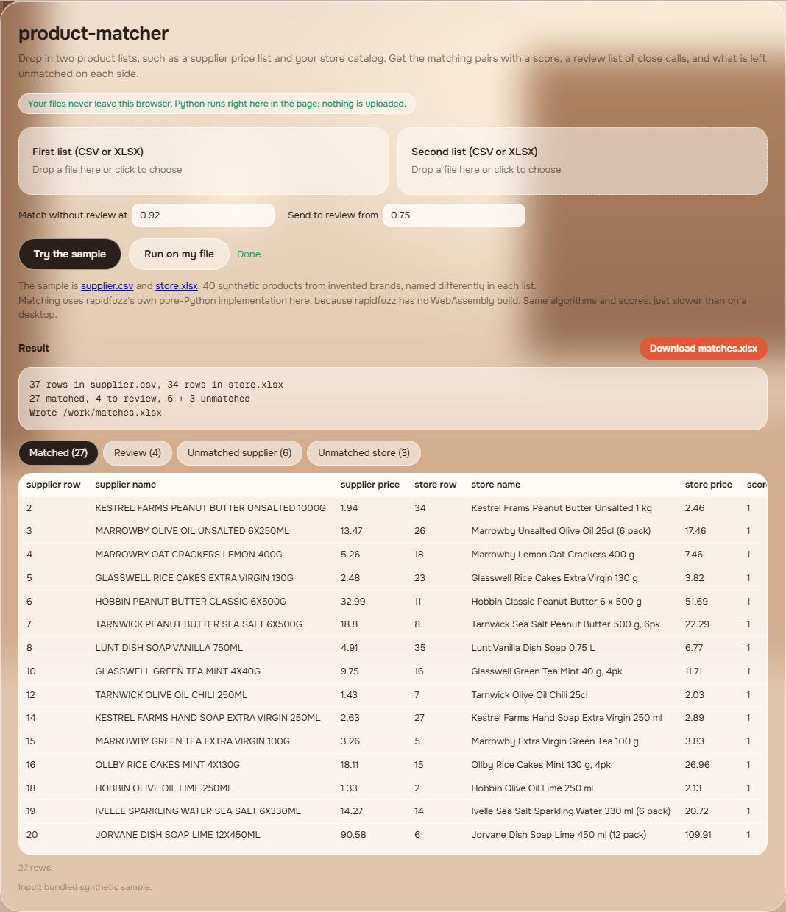

# product-matcher

[](https://github.com/chasebuilds/product-matcher/actions/workflows/ci.yml)  [](LICENSE)

**[Live demo: try it in your browser](https://chasebuilds.github.io/product-matcher/)**. Drop in your own file or run the bundled sample with one click. The real package runs in the page with Pyodide, so files never leave your browser.

[](https://chasebuilds.github.io/product-matcher/)

Matches product rows between two lists, for example a supplier price list and a store catalog. Rows with the same GTIN (UPC/EAN) or SKU are paired first. The rest are paired by name after both names are cleaned: sizes turned into one unit (`500ml`, `0.5 L` and `50cl` are the same), pack counts pulled out (`12 x`, `(12 pack)`, `12pk`), case and punctuation dropped and word order ignored. Names are scored with rapidfuzz. Sure pairs go to a Matched sheet, unsure ones to a Review sheet side by side, and the rest to an Unmatched sheet per list. Matched pairs show the price difference. Everything runs offline.

## Measured result

Two lists of invented products with known true pairs were run through the tool and scored. The table below is written by the benchmark script from a real run, not typed by hand. Method and limits: [BENCHMARK.md](BENCHMARK.md).

<!-- benchmark:start -->
| Measure | Result |
|---|---:|
| Products invented / rows in list A / rows in list B | 3,000 / 2,762 / 2,779 |
| True pairs (same product in both lists) | 2,541 |
| Auto-matched pairs that were right (precision) | **100.0%** (2,216 of 2,216) |
| True pairs auto-matched (recall) | **87.2%** (2,216 of 2,541) |
| Auto-matches made by GTIN or SKU | 22.6% (500) |
| List A rows sent to review | 5.5% (151) |
| Review pairs that were right | 69.5% (105 of 151) |
| True pairs found if review is checked by a person | **91.3%** |
<!-- benchmark:end -->

No wrong pair was auto-matched in this run. Every missed pair in this run is a store name with no brand. Those score below the auto line and go to review, or, with a typo as well, can fall below the review line. A different size or pack count cuts the score, so `500 ml` and `1 L` of the same drink are not matched. [LIMITATIONS.md](LIMITATIONS.md) has the rest.

## Example

| Supplier list | Store catalog | Score | Sheet, reason |
|---|---|---:|---|
| `MARROWBY OLIVE OIL UNSALTED 6X250ML` (with GTIN) | `Marrowby Unsalted Olive Oil 25cl (6 pack)` (same GTIN) | 1.00 | Matched, same GTIN |
| `MARROWBY OAT CRACKERS LEMON 400G` | `Marrowby Lemon Oat Crackers 400 g` | 1.00 | Matched, name 100, size same |
| `NORROW RICE CAKES LIME 4X130G` | `Lime Rice Cakes 130 g (4 pack)` | 0.81 | Review, name 81, size same |

## Quick start

Windows (on macOS or Linux use `.venv/bin/` in place of `.venv\Scripts\`):

```
python -m venv .venv
.venv\Scripts\python -m pip install -e .
.venv\Scripts\pmatch samples\supplier.csv samples\store.xlsx -o samples\matches.xlsx --auto 0.92 --review 0.75
```

The samples are 40 generated products from invented brands. The `true_id` column holds the right answer. The command prints:

```
37 rows in supplier.csv, 34 rows in store.xlsx
27 matched, 4 to review, 6 + 3 unmatched
Wrote samples\matches.xlsx
```

| Option | Effect |
|---|---|
| `--auto 0.92` | score at or above this is matched without review |
| `--review 0.75` | score at or above this (and below `--auto`) goes to review |
| `--name`, `--gtin`, `--sku`, `--price` | column names, when the guess is wrong (same name in both files) |
| `--sheet NAME` | sheet to read from Excel files (default: the first) |
| `-o FILE` | output workbook (default `matches.xlsx`) |

Columns are guessed from the header: name (`name`, `product`, `product name`, `description`, `item`, `title`), GTIN (`gtin`, `upc`, `ean`, `barcode`), SKU (`sku`, `item code`, `code`), price (`price`, `unit price`, `cost`). Exit codes: `0` done, `2` a file or column could not be read, or the thresholds are out of order.

## The output workbook

| Sheet | What it holds |
|---|---|
| Matched | row, name and price from each list, score, reason, price diff (B minus A) and price diff % |
| Review | the same columns for pairs scored in the gray band between `--review` and `--auto` |
| Unmatched (one per list) | rows with no pair: row, name, GTIN, SKU, price |

Row numbers match the spreadsheet row in the input file (the header is row 1). Each row is used in one pair at most. The highest scores are paired first.

## How a pair is scored

| Step | Rule |
|---|---|
| GTIN | digits only, leading zeros dropped, so a 12-digit UPC matches the same 13-digit EAN; score 1.0 |
| SKU | letters and digits only, upper case; score 1.0 |
| Name | rapidfuzz `token_sort_ratio` on the cleaned words, divided by 100 |
| Size | both sizes known and more than 2% apart, or ml against g: score times 0.6 |
| Size on one side only | score times 0.9 |
| Pack count | different: score times 0.6 |

As a library:

```python
from product_matcher.match import Row, match

r = match([Row("Brightvale Cola 12 x 330ml", price=6.0)], [Row("Cola Brightvale 33cl (12 pack)")])
r.matched[0].score, r.matched[0].reason   # (1.0, 'name 100, size same')
```

## Limits

Short version: it compares text, not meaning. Abbreviations (`Choc` for `Chocolate`) and missing brands lower the score. Sizes in different kinds of units (ml against g) never match. Full list: [LIMITATIONS.md](LIMITATIONS.md).

## Development

```
.venv\Scripts\python -m pip install -e ".[dev]"
.venv\Scripts\python -m pytest --cov
.venv\Scripts\python -m ruff check .
.venv\Scripts\python -m mypy
.venv\Scripts\python -m benchmark.run_benchmark
```

The sample files were made with `python -m benchmark.generate --seed 7 --products 40 --out samples`.

## License

MIT. See [LICENSE](LICENSE).
